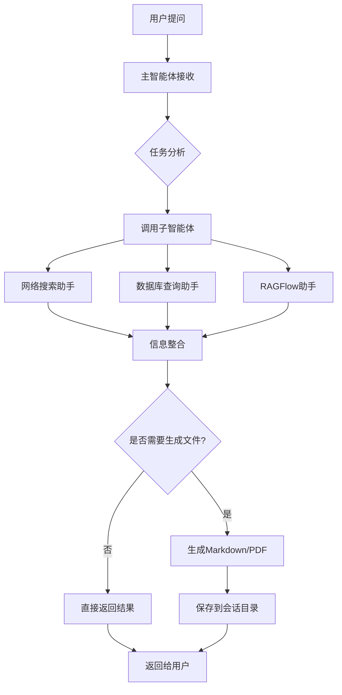

# Deep-Search 智能搜索系统

<div align="center">

**基于多智能体架构的企业级智能搜索与知识管理平台**

[](https://www.python.org/)
[](https://fastapi.tiangolo.com/)
[](LICENSE)

</div>

## 📖 项目简介

Deep-Search 是一个面向沃华医药公司的智能团队负责人系统，采用先进的多智能体架构，协调三个专家助手完成复杂任务：
- **网络搜索助手** - 负责从互联网检索公开信息
- **数据库查询助手** - 负责查询企业内部数据库（药品信息、库存、销售数据等）
- **RAGFlow助手** - 负责与RAGFlow知识库交互，检索企业内部专有知识

系统支持多种输出格式（Markdown、PDF、Word），并提供实时会话进度监控功能。

## 🏗️ 系统架构

### 核心架构特点

- **多智能体协作系统** - 基于 DeepAgents 框架，主智能体协调三个子智能体
- **前后端分离** - FastAPI 后端 + Vue.js 前端
- **会话隔离机制** - 每个会话独立的工作目录和上下文管理
- **实时监控** - WebSocket 双向通信，实时推送任务执行状态

### 技术栈

#### 后端技术栈
- **Web框架**: FastAPI 0.136+
- **AI框架**: LangChain-OpenAI, DeepAgents 0.6.6+
- **数据库**: MySQL Connector 9.7+
- **知识库**: RAGFlow SDK 0.24.0
- **搜索引擎**: Tavily API
- **文件处理**: 
  - PDF: PyPDF 6.12+
  - Word: Python-docx 1.2+
  - Excel: OpenPyXL 3.1+
  - Markdown: markdown 3.10+
- **服务器**: Uvicorn 0.48+
- **配置管理**: python-dotenv, PyYAML

#### 前端技术栈
- **框架**: Vue.js 3
- **构建工具**: Vite
- **UI组件**: Element Plus (推测)

## 📁 项目结构

```
deep-search/
├── agent/                      # 智能体模块
│   ├── sub_agents/            # 子智能体
│   │   ├── internet_sub_agent.py  # 网络搜索助手
│   │   ├── db_sub_agent.py        # 数据库查询助手
│   │   └── rag_sub_agent.py       # RAGFlow助手
│   ├── main_agent.py          # 主智能体（核心协调逻辑）
│   ├── llm.py                 # LLM 模型配置
│   └── load_prompt.py         # Prompt 配置加载
├── api/                       # API 服务模块
│   ├── server.py              # FastAPI 服务器入口
│   ├── context.py             # 会话上下文管理
│   └── monitor.py             # 实时监控（WebSocket）
├── tools/                     # 工具模块
│   ├── internet_search_tool.py    # 网络搜索工具
│   ├── mysql_tools.py             # 数据库操作工具
│   ├── ragflow_tools.py           # RAGFlow 交互工具
│   ├── pdf_tools.py               # PDF 生成工具
│   ├── markdown_tools.py          # Markdown 生成工具
│   └── upload_file_read_tool.py   # 文件读取工具
├── prompt/                    # Prompt 配置
│   └── prompts.yaml           # 所有智能体的 Prompt
├── ui/                        # 前端项目
├── output/                    # 会话输出目录（自动生成）
├── upload/                    # 用户上传文件目录
├── sql/                       # 数据库脚本
├── utils/                     # 工具类
├── main.py                    # 程序入口
├── pyproject.toml             # Python 项目配置
└── .env                       # 环境变量配置
```

## ✨ 核心功能

### 1. 多智能体协作

- **主智能体** - 任务规划、子智能体调度、结果整合
- **网络搜索助手** - 多角度检索，最多3次迭代搜索
- **数据库查询助手** - 表结构探索、数据预览、SQL查询
- **RAGFlow助手** - 知识库问答，渐进式深入提问

### 2. 文件处理能力

- 支持上传多种格式文件（PDF、Word、Excel、Markdown等）
- 自动生成 Markdown、PDF 文档
- 会话级文件隔离管理

### 3. 实时监控与交互

- WebSocket 双向通信
- 任务执行进度实时推送
- 会话状态管理

### 4. 安全机制

- 路径遍历攻击防护
- 会话隔离
- 文件访问权限控制

## 🚀 快速开始

### 环境要求

- Python 3.12+
- MySQL 数据库
- RAGFlow 服务（可选）
- Tavily API Key

### 安装步骤

#### 1. 克隆项目

```bash
git clone https://github.com/Qw462/deep-search.git
cd deep-search
```

#### 2. 安装 Python 依赖

使用 [uv](https://github.com/astral-sh/uv)（推荐）：

```bash
# 安装 uv
pip install uv

# 安装依赖
uv sync
```

或使用 pip：

```bash
pip install -r requirements.txt
```

#### 3. 配置环境变量

创建 `.env` 文件：

```env
# MySQL 数据库配置
MYSQL_HOST=localhost
MYSQL_PORT=3306
MYSQL_USER=root
MYSQL_PASSWORD=your_password
MYSQL_DATABASE=your_database

# RAGFlow 配置
RAGFLOW_API_URL=http://localhost:9380
RAGFLOW_API_KEY=your_ragflow_api_key

# LLM 配置
DASHSCOPE_API_KEY=your_dashscope_api_key
DASHSCOPE_BASE_URL=https://dashscope.aliyuncs.com/compatible-mode/v1
LLM_QWEN_PLUS=qwen-plus

# 搜索工具配置
TAVILY_API_KEY=your_tavily_api_key
```

#### 4. 初始化数据库

```bash
# 执行 SQL 脚本
mysql -u root -p < sql/db.sql
```

#### 5. 启动后端服务

```bash
python main.py
```

服务将在 `http://0.0.0.0:8000` 启动

#### 6. 启动前端服务（开发模式）

```bash
cd ui
npm install
npm run dev
```

## 📡 API 接口文档

### 1. 任务执行接口

**POST** `/api/task`

执行智能体任务

**请求体**:
```json
{
  "query": "用户问题",
  "thread_id": "会话ID（可选）"
}
```

**响应**:
```json
{
  "status": "started",
  "thread_id": "生成的会话ID"
}
```

### 2. 文件上传接口

**POST** `/api/upload`

上传文件供智能体分析

**参数**:
- `files`: 文件列表（multipart/form-data）
- `thread_id`: 会话ID

### 3. 文件下载接口

**GET** `/api/download?path=文件路径`

下载生成的文件

### 4. 文件列表接口

**GET** `/api/files?path=目录路径`

列出指定目录下的所有文件

### 5. WebSocket 接口

**WS** `/ws/{thread_id}`

实时通信，接收任务执行进度

## 🔧 配置说明

### Prompt 配置

所有智能体的 Prompt 配置在 `prompt/prompts.yaml` 中，包括：
- 主智能体系统提示词
- 各子智能体的描述和指令

### 工具配置

- **网络搜索**: 使用 Tavily API，需在 `.env` 中配置 `TAVILY_API_KEY`
- **数据库**: 配置 MySQL 连接信息
- **RAGFlow**: 配置 RAGFlow 服务地址和 API Key

## 📊 工作流程



## 🛠️ 开发指南

### 添加新的子智能体

1. 在 `agent/sub_agents/` 创建新的子智能体文件
2. 在 `prompt/prompts.yaml` 添加配置
3. 在 `agent/main_agent.py` 中注册子智能体

### 添加新的工具

1. 在 `tools/` 目录创建工具文件
2. 使用 `@tool` 装饰器定义工具函数
3. 在相应智能体中导入并使用

## 📝 使用示例

### 示例1：查询药品信息

```
用户：请帮我查询阿莫西林胶囊的库存和销售情况

系统执行流程：
1. 主智能体分析任务
2. 调用数据库查询助手获取药品信息
3. 整合结果并返回
```

### 示例2：生成分析报告

```
用户：请分析本月药品销售数据，生成PDF报告

系统执行流程：
1. 调用数据库查询助手获取销售数据
2. 调用网络搜索助手获取行业对比数据
3. 主智能体整合所有信息
4. 生成 Markdown 文档
5. 转换为 PDF
6. 返回给用户
```

## 🔍 常见问题

### 1. 数据库连接失败

**解决**: 检查 `.env` 中的 MySQL 配置是否正确，确保数据库服务已启动

### 2. RAGFlow 连接超时

**解决**: 确认 RAGFlow 服务已启动，检查 `RAGFLOW_API_URL` 和端口配置

### 3. Tavily 搜索无结果

**解决**: 验证 `TAVILY_API_KEY` 是否正确，检查网络连接

### 4. 文件生成失败

**解决**: 确保 `output/` 目录有写入权限，检查路径是否正确

## 🤝 贡献指南

欢迎贡献！请遵循以下步骤：

1. Fork 本仓库
2. 创建特性分支 (`git checkout -b feature/AmazingFeature`)
3. 提交更改 (`git commit -m 'Add some AmazingFeature'`)
4. 推送到分支 (`git push origin feature/AmazingFeature`)
5. 提交 Pull Request

## 📄 许可证

本项目采用 MIT 许可证 - 详见 [LICENSE](LICENSE) 文件


## 🙏 致谢

- [DeepAgents](https://github.com/deepagents) - 多智能体框架
- [LangChain](https://github.com/langchain-ai/langchain) - LLM 应用开发框架
- [FastAPI](https://fastapi.tiangolo.com/) - Web 框架
- [RAGFlow](https://github.com/infiniflow/ragflow) - 知识库引擎
- [Tavily](https://tavily.com/) - 搜索 API

---

<div align="center">

**如果这个项目对你有帮助，请给一个 ⭐️ Star 支持！**

</div>
